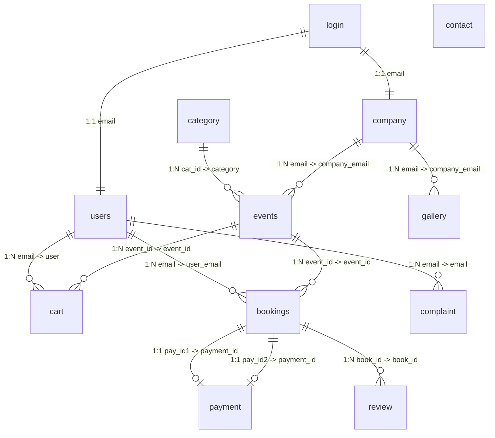
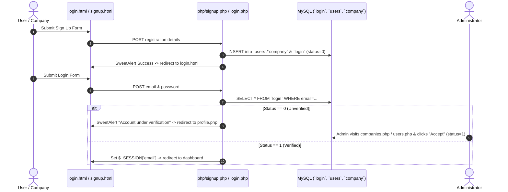
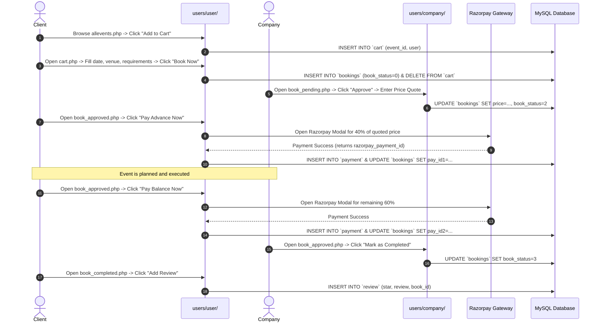

# CRYSTAL EVENTS — COMPREHENSIVE ARCHITECTURAL, CODE QUALITY & SECURITY AUDIT REPORT

**Date of Audit:** October 31, 2026  
**Audited System:** Crystal Events — Legacy PHP/MySQL Event Management Platform  
**Target Environment:** XAMPP (Windows x64) / PHP 8.5.12  
**Scope:** Read-Only Source Code, Environment & Database Audit  
**Author:** DeepMind Antigravity Pair Programmer  

---

## 1. Executive Summary

"Crystal Events" is a monolithic PHP + MySQL multi-tenant event management platform designed to connect event organizing agencies with clients seeking event management services (weddings, corporate celebrations, parties, etc.), overseen by a system administrator.

The platform was originally built approximately two years ago. However, architectural forensics reveals that **the project is a heavily modified fork of an earlier motorcycle dealership/rental web application** (likely named "AutoDoc" or a bike showroom platform). Extensive vestigial artifacts—including bike upload directories, database queries referencing `bike`, `customer`, `pro_order`, and `test_book`, unused email templates referring to "test drives" and "delivered orders", and commented-out dashboard widgets—remain scattered throughout the codebase.

### Current Operational Readiness: **BLOCKED / NON-FUNCTIONAL**
The application **cannot be executed in its current state** due to several foundational blockers:
1. **No Database Schema or SQL Dump exists in the repository.** The database `crystal-events` is not present in MySQL, and no initialization script is provided.
2. **Repository Location:** The codebase currently resides in `C:\Users\shibin shajan kp\Downloads\Crystal-Events`, rather than the active web server document root (`C:\xampp\htdocs\`).
3. **Port 80 Conflict:** Apache in XAMPP is offline because Windows World Wide Web Publishing Service (`w3svc` / IIS) is running and bound to port 80.
4. **PHP 8.5 Incompatibilities:** Starting in PHP 8.1+, MySQLi defaults to `MYSQLI_REPORT_ERROR | MYSQLI_REPORT_STRICT`. Query failures (such as missing tables or queries referencing old bike tables) throw fatal `mysqli_sql_exception` halts instead of silently returning `false`.
5. **Fatal Include and Query Errors:** Broken relative paths (`require("../php/connect.php")` in user invoice views) and SQL queries referencing non-existent tables (`customer`) and non-existent columns (`email_id`) completely break several core modules.
6. **Critical Security Flaws:** The platform suffers from pervasive SQL Injection across almost every query, plaintext password storage, arbitrary file uploads enabling Remote Code Execution (RCE), unauthenticated admin actions, and absence of Razorpay webhook/signature verification.

---

## 2. Project Overview & Architecture

### 2.1 Core Purpose & Value Proposition
Crystal Events acts as an intermediary platform:
- **Event Companies** register their profile, upload portfolios and photo galleries, list service packages (e.g., wedding planning, catering, staging), review booking requests, submit price quotations, and track execution status.
- **Clients (Users)** discover organizers, browse events, add desired services to a cart, submit localized booking requirements with date/place/notes, pay a 40% advance payment via Razorpay upon approval, settle the 60% balance upon event readiness, and rate/review the organizer.
- **Admin** moderates user and company onboarding (approving or deleting registrations), manages global event categories, inspects contact inquiries, and responds to user complaints.

### 2.2 User Roles & Access Hierarchy

| Role | User Type ID | Login Status | Key Capabilities |
| :--- | :---: | :---: | :--- |
| **Visitor / Guest** | N/A | Unauthenticated | Views public home page (`index.php`), static informational pages (`about.html`, `contact.html`), browses featured verified companies, submits public contact inquiries, navigates to sign up or log in. |
| **User (Customer / Client)** | `2` | `0` (Pending) | Restricted to `users/user/profile.php`. Must complete profile (address, phone, bank account, DOB) while awaiting admin verification. |
| **User (Customer / Client)** | `2` | `1` (Verified) | Full access to user portal (`users/user/`): searches events/companies, manages cart, submits bookings, pays advance and balance via Razorpay, views completed events, posts star reviews, logs complaints. |
| **Company (Organizer / Vendor)** | `3` | `0` (Pending) | Restricted to `users/company/profile.php`. Must fill in business details (owner name, established date, bank details, place, bio) awaiting admin approval. |
| **Company (Organizer / Vendor)** | `3` | `1` (Verified) | Full access to vendor portal (`users/company/`): creates and manages event packages, uploads gallery photos, reviews booking requests (approves with custom quotation or rejects with reason), tracks payment statuses, marks events as completed. |
| **Administrator** | `1` | `1` (Active) | Master control in `users/admin/`: verifies/approves or deletes registered companies and users, creates service categories, reads contact messages, resolves customer complaints, changes admin password. |

---

### 2.3 Comprehensive Folder & File Structure

```
Crystal-Events/
├── about.html                  # Public informational "About Us" page (static HTML)
├── cart.html                   # Static template leftover (mockup, unlinked in production flow)
├── checkout.html               # Static template leftover (mockup, unlinked in production flow)
├── contact.html                # Public contact form; posts message to php/contact.php
├── event.html                  # Static template mockup for events catalog
├── index.php                   # Main public landing page; displays dynamic verified/top-rated companies
├── login.html                  # Public split login portal for all three roles
├── rating.html                 # Static review widget template (isolated HTML/CSS)
├── README.md                   # 18-byte placeholder file containing only "# Crystal-Events"
├── signup.html                 # Public dual registration portal (User / Company)
│
├── css/                        # Global public styling assets
│   ├── all.min.css             # FontAwesome 5 bundled CSS
│   ├── bootstrap.min.css       # Bootstrap v5.0.0 compiled stylesheet
│   ├── rating.css              # Custom 5-star rating widget CSS rules
│   └── style.css               # Theme overrides for landing page and public template
│
├── event img/                  # High-resolution portfolio images organized by company name
│   ├── cevex events/           # Corporate & wedding showcase imagery for "Cevex"
│   ├── dolphin events/         # Portfolio photos for "Dolphin Events"
│   ├── Eventique House/        # Stage and wedding photography for "Eventique House"
│   ├── eventos magic/          # Wedding decoration and stage photos for "Eventos Magic"
│   ├── executive evnts/        # Production and setup imagery for "Executive Events"
│   ├── fonix/                  # Wedding planner imagery for "Fonix"
│   ├── giaan media/            # Corporate media and setup photography for "Giaan Media"
│   ├── hooray events/          # Celebration setup images for "Hooray Events"
│   ├── icecubes/               # Stage setup imagery for "Ice Cubes"
│   ├── magnolia events/        # Floral decoration images for "Magnolia Events"
│   ├── make my day/            # Portfolio photos for "Make My Day Events"
│   ├── maritus events/         # Wedding staging images for "Maritus Events"
│   ├── oakstreet events/       # Banquet and reception imagery for "Oakstreet Events"
│   ├── one touch/              # Event photography for "One Touch Events"
│   ├── party.jpg               # Standalone stock party banner image
│   └── trisol events/          # Portfolio photos for "Trisol Events"
│
├── img/                        # Public branding assets and logo graphics
│   ├── avatar.jpg              # Default user avatar placeholder
│   ├── Crystal events...jpeg   # High-resolution branding mockups & logo variants
│   ├── logo.png                # Primary transparent platform logo
│   └── payment.png             # Payment gateway banner graphic
│
├── js/                         # Global front-end scripts
│   ├── jquery.3.6.1.min.js     # jQuery 3.6.1 production library
│   ├── main.js                 # Public template UI logic (carousel, sticky navbar, spinner)
│   └── sweetalert2@11.js       # SweetAlert2 modal notification library
│
├── lib/                        # Third-party front-end plugins
│   ├── easing/                 # jQuery Easing v1.3 animation helper
│   ├── lightbox/               # Lightbox v2 responsive image viewer (CSS, JS, icons)
│   ├── owlcarousel/            # Owl Carousel 2 touch-enabled slider plugin
│   └── waypoints/              # Waypoints scroll trigger library & links.php helper
│
├── mail-templates/             # Legacy transactional HTML email templates (Unused in active code)
│   ├── order_delivered.html    # Old bike delivery notification template
│   ├── payment.html            # Generic payment confirmation template
│   ├── test_drive_complete.html# Cloned motorcycle test drive completion template
│   └── welcome.html            # Registration welcome template
│
├── php/                        # Core shared backend handlers
│   ├── connect.php             # Database connection, timezone setting, CRUD helper functions
│   ├── contact.php             # Public contact form submission processor
│   ├── keys.php                # Razorpay API key configuration ($apikey)
│   ├── login.php               # Universal authentication endpoint with role-based routing
│   ├── logout.php              # Session destruction and redirection script
│   └── signup.php              # User and Company registration processor
│
├── users/                      # Role-segregated administrative and client dashboards
│   ├── admin/                  # System Administrator Portal
│   │   ├── category.php        # Manage and create event service categories
│   │   ├── companies.php       # Company account approval/rejection moderation table
│   │   ├── complaints.php      # User complaint review and response manager
│   │   ├── footer.php          # Admin dashboard footer scripts and SweetAlert logout handler
│   │   ├── header.php          # Admin session verification, navigation sidebar, topbar
│   │   ├── index.php           # Admin metrics overview (counts of users and companies)
│   │   ├── messages.php        # Contact inquiries reader table
│   │   ├── password.php        # Admin password modification interface
│   │   ├── users.php           # User account approval/rejection moderation table
│   │   ├── css/, fonts/, js/   # W3layouts "Colored" admin theme assets (Bootstrap 4, DataTables)
│   │   ├── uploads/            # Admin asset storage
│   │   │   ├── bikes/          # Vestigial folder containing 40+ high-res superbike photos
│   │   │   └── profile/        # Admin default profile picture (default.jpg)
│   │   └── php/                # Admin asynchronous backend action endpoints
│   │       ├── accept_or_reject.php # Approves (status=1) or deletes (status=0) accounts
│   │       ├── category.php    # Inserts new service categories
│   │       ├── complaint.php   # Updates complaint reply and sets status to Closed (2)
│   │       └── passwordchange.php # Updates admin plaintext password in login table
│   │
│   ├── company/                # Event Organizer / Company Portal
│   │   ├── addevents.php       # Form to publish new event packages/services
│   │   ├── book_approved.php   # Table of approved bookings awaiting execution & payment
│   │   ├── book_completed.php  # History of completed bookings
│   │   ├── book_pending.php    # Incoming inquiries awaiting price quote or rejection
│   │   ├── complaints.php      # Broken complaint reader (queries non-existent customer table)
│   │   ├── footer.php          # Vendor dashboard footer scripts and logout handler
│   │   ├── gallery.php         # Photo gallery manager (upload showcase photos with captions)
│   │   ├── header.php          # Vendor session verification, company menu, profile header
│   │   ├── index.php           # Vendor home dashboard (currently blank; metrics commented out)
│   │   ├── password.php        # Vendor password modification interface
│   │   ├── profile.php         # Vendor company profile editor & profile picture upload
│   │   ├── viewevents.php      # Grid of services published by the logged-in company
│   │   ├── css/, fonts/, js/   # W3layouts vendor dashboard theme assets
│   │   ├── uploads/            # Vendor persistent uploads
│   │   │   ├── gallery/        # Uploaded event portfolio images
│   │   │   └── profile/        # Vendor company logo/avatar images
│   │   └── php/                # Vendor asynchronous backend action endpoints
│   │       ├── addevents.php   # Inserts new event records into `events` table
│   │       ├── book_approved.php# Marks booking as executed/completed (book_status=3)
│   │       ├── book_pending.php# Submits price quote (status=2) or rejection reply (status=1)
│   │       ├── complaint.php   # Vendor complaint reply endpoint
│   │       ├── gallery.php     # Uploads photo to gallery folder and inserts record
│   │       ├── passwordchange.php # Broken vendor password changer (queries non-existent `email_id`)
│   │       ├── profile.php     # Updates company contact, banking, and establishment info
│   │       └── profile_pic.php # Uploads and updates company avatar image
│   │
│   └── user/                   # End-User / Client Customer Portal
│       ├── allevents.php       # Live searchable and category-filtered events catalog
│       ├── book_approved.php   # Approved bookings table with Razorpay payment buttons
│       ├── book_completed.php  # Completed bookings table with modal star rating & review
│       ├── book_pending.php    # Pending booking inquiries with edit and cancel capabilities
│       ├── cart.php            # Cart table to specify date, place, district, requirements
│       ├── companies.php       # Live searchable list of registered event companies
│       ├── complaint.php       # User complaint submission form and ticket status table
│       ├── footer.php          # User dashboard footer scripts and active menu state
│       ├── header.php          # User session verification, live cart badge count, topbar
│       ├── index.php           # User home dashboard showing 3 featured random events
│       ├── invoice.php         # Broken invoice view (broken require and queries `pro_order`)
│       ├── invoice2.php        # Broken invoice view (broken require and queries `test_book`)
│       ├── order.php           # Dead unlinked page from bike project (queries `bike`, `pro_order`)
│       ├── password.php        # User password modification interface
│       ├── profile.php         # User profile editor and profile picture upload
│       ├── view.php            # In-depth company profile view (about, gallery carousel, reviews)
│       ├── css/, fonts/, js/   # W3layouts user dashboard theme assets
│       ├── uploads/            # User uploads storage
│       │   └── profile/        # User profile pictures
│       └── php/                # User asynchronous backend action endpoints
│           ├── allevents.php   # Live AJAX search/filter endpoint for events catalog
│           ├── book_pending.php# Updates event date/place or cancels/deletes booking
│           ├── cart.php        # Adds/removes items from cart and converts cart to bookings
│           ├── companies.php   # Live AJAX search endpoint for company listings
│           ├── complaint.php   # Inserts user complaint ticket
│           ├── menu.php        # Persists active navigation tab into $_SESSION['menu']
│           ├── passwordchange.php # Updates user plaintext password in login table
│           ├── profile.php     # Updates personal, residential, and bank account details
│           ├── profile_pic.php # Uploads and updates user avatar image
│           ├── review.php      # Inserts star rating and feedback into `review` table
│           ├── success.php     # Records 40% advance payment & updates `pay_id1`
│           └── success2.php    # Records 60% balance payment & updates `pay_id2`
│
└── webfonts/                   # FontAwesome 5 standalone font files (woff, woff2, ttf)
```

### 2.4 Entry Points
- **Public Website Landing:** `index.php` (Root)
- **User / Vendor / Admin Login:** `login.html` (Submits POST credentials to `php/login.php`)
- **User / Vendor Sign Up:** `signup.html` (Submits POST registration to `php/signup.php`)
- **Admin Dashboard Direct Entry:** `users/admin/index.php` (Guarded by `users/admin/header.php`)
- **Company Dashboard Direct Entry:** `users/company/index.php` (Guarded by `users/company/header.php`)
- **User Dashboard Direct Entry:** `users/user/index.php` (Guarded by `users/user/header.php`)

---

## 3. Tech Stack & Environment Audit

### 3.1 Software Stack Specification
- **Backend Language:** PHP 7.4 – 8.0 target compatibility (procedural script execution with custom `mysqli` wrapper functions).
- **PHP Extensions Required:** `mysqli`, `session`, `date`, `fileinfo`, `json`, `mbstring`, `openssl`.
- **Dependency Management:** **None.** No `composer.json`, no `composer.lock`, and no `vendor/` directory. All third-party libraries are manually bundled.
- **Front-End Stack:**
  - *Public Landing / Marketing Pages:* Bootstrap v5.0.0 (`css/bootstrap.min.css`), jQuery 3.6.1, SweetAlert2 v11, Owl Carousel 2, Lightbox v2, FontAwesome 5.15.4, Bootstrap Icons.
  - *Admin / Company / User Portals:* Bootstrap v4.1.3 (via CDN), W3layouts "Colored Responsive" dashboard CSS (`style.css`, `proton.css`), jQuery 2.0.3 & 3.6.1, DataTables 1.13.6, DataTables Buttons 2.4.2 (JSZip, pdfmake), SweetAlert2 v11, FontAwesome 4.7.
- **External Payment SDK:** Razorpay Standard Checkout SDK (`https://checkout.razorpay.com/v1/checkout.js`).
- **Web Server Requirements:** Apache 2.4+ (or Nginx with PHP-FPM). No `.htaccess` or URL rewrite rules are present; requests target physical `.php` and `.html` files directly.

---

### 3.2 Host Machine Diagnostic

A diagnostic sweep of the current Windows system revealed the following findings:

| Component | Status on Machine | Details / Findings |
| :--- | :---: | :--- |
| **PHP Executable** | Installed | **PHP 8.5.12 (CLI)** (ZTS Visual C++ 2022 x64) located at `C:\xampp\php\php.exe`. *Note:* `php` is not registered in the system environment `PATH` variable. |
| **PHP Modules** | Active | `mysqli`, `session`, `curl`, `json`, `mbstring`, `fileinfo`, `openssl`, `pdo_mysql` are properly enabled in `C:\xampp\php\php.ini`. |
| **XAMPP Control Panel** | Running | `xampp-control.exe` is currently running under Process ID **20292**. |
| **Apache Web Server** | **Stopped** | `httpd.exe` is **NOT running**. It cannot be started in default configuration due to a port collision. |
| **Port 80 Listener** | **Occupied** | Port 80 is currently occupied by **PID 4 (Windows System Kernel)**. The service **`w3svc` (World Wide Web Publishing Service / IIS)** is running, preventing Apache from binding to port 80. |
| **MySQL / MariaDB** | **Stopped** | `mysqld.exe` is **NOT running**. Port 3306 is unbound. |
| **MySQL Data Store** | Inspected | `C:\xampp\mysql\data` contains default databases (`mysql`, `performance_schema`, `phpmyadmin`, `sys`, `test`). **No `crystal-events` database exists.** |
| **Workspace Location** | **Outside htdocs** | The repository is in `C:\Users\shibin shajan kp\Downloads\Crystal-Events`, whereas XAMPP serves web traffic out of `C:\xampp\htdocs\`. |

---

## 4. Database Analysis & Complete Schema Blueprint

### 4.1 SQL Dump & Schema Availability
> [!CAUTION]
> **No `.sql` schema file, database dump, or migration script exists anywhere in the repository or within XAMPP.**

### 4.2 Database Connection Configuration
Configured in `php/connect.php`:
```php
$conn = mysqli_connect('localhost', "root", "", "crystal-events");
if (!$conn) die("connection fail");
date_default_timezone_set("Asia/Kolkata");
```
- **Host:** `localhost`
- **User:** `root`
- **Password:** `""` (Empty password)
- **Database Name:** `crystal-events` (Contains a hyphen; requires backtick escaping in raw DDL/SQL statements)
- **Timezone:** `Asia/Kolkata` (IST)

---

### 4.3 Inferred Database Schema (12 Application Tables)

By reverse-engineering every SQL `SELECT`, `INSERT`, `UPDATE`, `DELETE`, and `JOIN` across all PHP files, the following complete schema has been reconstructed:



#### Detailed Table Specifications

#### 1. `login` (Authentication & Access Control)
Stores user credentials and authorization state for all three user roles.
```sql
CREATE TABLE `login` (
  `email` VARCHAR(255) NOT NULL,
  `password` VARCHAR(255) NOT NULL, -- Stored as PLAINTEXT
  `usertype` INT(1) NOT NULL,       -- 1 = Admin, 2 = User/Customer, 3 = Company/Vendor
  `status` INT(1) NOT NULL DEFAULT 0, -- 0 = Pending verification, 1 = Verified/Active
  PRIMARY KEY (`email`)
) ENGINE=InnoDB DEFAULT CHARSET=utf8mb4;
```

#### 2. `users` (Client / Customer Profiles)
Contains personal, demographic, and financial details of end users.
```sql
CREATE TABLE `users` (
  `email` VARCHAR(255) NOT NULL,
  `firstname` VARCHAR(100) NOT NULL,
  `lastname` VARCHAR(100) NOT NULL,
  `phone` VARCHAR(20) DEFAULT NULL,
  `housename` VARCHAR(255) DEFAULT NULL,
  `place` VARCHAR(255) DEFAULT NULL,
  `district` VARCHAR(100) DEFAULT NULL,
  `pincode` VARCHAR(10) DEFAULT NULL,
  `date_of_birth` DATE DEFAULT NULL,
  `acc_no` VARCHAR(50) DEFAULT NULL,
  `ifsc_code` VARCHAR(20) DEFAULT NULL,
  `profile_pic` VARCHAR(255) NOT NULL DEFAULT 'default.jpg',
  PRIMARY KEY (`email`),
  CONSTRAINT `fk_users_login` FOREIGN KEY (`email`) REFERENCES `login` (`email`) ON DELETE CASCADE
) ENGINE=InnoDB DEFAULT CHARSET=utf8mb4;
```

#### 3. `company` (Event Management Companies)
Contains business registration, operational details, and portfolio biography.
```sql
CREATE TABLE `company` (
  `email` VARCHAR(255) NOT NULL,
  `name` VARCHAR(255) NOT NULL,
  `ownername` VARCHAR(255) DEFAULT NULL,
  `phone` VARCHAR(20) DEFAULT NULL,
  `place` VARCHAR(255) DEFAULT NULL,
  `district` VARCHAR(100) DEFAULT NULL,
  `pincode` VARCHAR(10) DEFAULT NULL,
  `est_date` DATE DEFAULT NULL,
  `acc_no` VARCHAR(50) DEFAULT NULL,
  `ifsc_code` VARCHAR(20) DEFAULT NULL,
  `aadhar` VARCHAR(50) DEFAULT NULL,
  `about` TEXT DEFAULT NULL,
  `profile_pic` VARCHAR(255) NOT NULL DEFAULT 'default.jpg',
  PRIMARY KEY (`email`),
  CONSTRAINT `fk_company_login` FOREIGN KEY (`email`) REFERENCES `login` (`email`) ON DELETE CASCADE
) ENGINE=InnoDB DEFAULT CHARSET=utf8mb4;
```

#### 4. `category` (Service Categories)
Master lookup table for classification of event services.
```sql
CREATE TABLE `category` (
  `cat_id` INT(11) NOT NULL AUTO_INCREMENT,
  `cat_title` VARCHAR(255) NOT NULL,
  PRIMARY KEY (`cat_id`)
) ENGINE=InnoDB DEFAULT CHARSET=utf8mb4;
```

#### 5. `events` (Event Packages & Services)
Services offered by specific event companies.
```sql
CREATE TABLE `events` (
  `event_id` INT(11) NOT NULL AUTO_INCREMENT,
  `name` VARCHAR(255) NOT NULL,
  `category` INT(11) NOT NULL,
  `description` TEXT NOT NULL,
  `company_email` VARCHAR(255) NOT NULL,
  PRIMARY KEY (`event_id`),
  CONSTRAINT `fk_events_cat` FOREIGN KEY (`category`) REFERENCES `category` (`cat_id`) ON DELETE CASCADE,
  CONSTRAINT `fk_events_company` FOREIGN KEY (`company_email`) REFERENCES `company` (`email`) ON DELETE CASCADE
) ENGINE=InnoDB DEFAULT CHARSET=utf8mb4;
```

#### 6. `cart` (User Wishlist / Pending Bookings Queue)
Temporary staging table before bookings are formally submitted.
```sql
CREATE TABLE `cart` (
  `cart_id` INT(11) NOT NULL AUTO_INCREMENT,
  `event_id` INT(11) NOT NULL,
  `user` VARCHAR(255) NOT NULL,
  PRIMARY KEY (`cart_id`),
  CONSTRAINT `fk_cart_event` FOREIGN KEY (`event_id`) REFERENCES `events` (`event_id`) ON DELETE CASCADE,
  CONSTRAINT `fk_cart_user` FOREIGN KEY (`user`) REFERENCES `users` (`email`) ON DELETE CASCADE
) ENGINE=InnoDB DEFAULT CHARSET=utf8mb4;
```

#### 7. `bookings` (Event Booking Contracts)
Core transaction table tracking event schedule, location, pricing, and multi-stage status.
```sql
CREATE TABLE `bookings` (
  `book_id` INT(11) NOT NULL AUTO_INCREMENT,
  `event_id` INT(11) NOT NULL,
  `user_email` VARCHAR(255) NOT NULL,
  `requirements` TEXT NOT NULL,
  `event_date_time` DATETIME NOT NULL,
  `event_place` VARCHAR(255) NOT NULL,
  `event_district` VARCHAR(100) NOT NULL,
  `event_pincode` VARCHAR(10) NOT NULL,
  `price` DECIMAL(10,2) DEFAULT NULL,
  `reply` TEXT DEFAULT NULL,
  `book_status` INT(1) NOT NULL DEFAULT 0, -- 0 = Pending, 1 = Rejected, 2 = Approved, 3 = Completed
  `pay_id1` INT(11) NOT NULL DEFAULT 0,   -- Ref to payment (40% advance)
  `pay_id2` INT(11) NOT NULL DEFAULT 0,   -- Ref to payment (60% balance)
  PRIMARY KEY (`book_id`),
  CONSTRAINT `fk_bookings_event` FOREIGN KEY (`event_id`) REFERENCES `events` (`event_id`) ON DELETE CASCADE,
  CONSTRAINT `fk_bookings_user` FOREIGN KEY (`user_email`) REFERENCES `users` (`email`) ON DELETE CASCADE
) ENGINE=InnoDB DEFAULT CHARSET=utf8mb4;
```

#### 8. `payment` (Transaction Records)
Records Razorpay transaction details for advance and balance settlements.
```sql
CREATE TABLE `payment` (
  `payment_id` INT(11) NOT NULL AUTO_INCREMENT,
  `amount` DECIMAL(10,2) NOT NULL,
  `paid_date` DATETIME NOT NULL,
  `ref_id` VARCHAR(255) NOT NULL, -- Razorpay Payment ID
  PRIMARY KEY (`payment_id`)
) ENGINE=InnoDB DEFAULT CHARSET=utf8mb4;
```

#### 9. `review` (Ratings & Testimonials)
User ratings and written reviews for completed events.
```sql
CREATE TABLE `review` (
  `review_id` INT(11) NOT NULL AUTO_INCREMENT,
  `book_id` INT(11) NOT NULL,
  `star` INT(1) NOT NULL, -- Integer from 1 to 5
  `review` TEXT NOT NULL,
  `review_date` DATETIME NOT NULL,
  PRIMARY KEY (`review_id`),
  CONSTRAINT `fk_review_booking` FOREIGN KEY (`book_id`) REFERENCES `bookings` (`book_id`) ON DELETE CASCADE
) ENGINE=InnoDB DEFAULT CHARSET=utf8mb4;
```

#### 10. `gallery` (Company Portfolio Showcase)
Photo gallery uploaded by vendors.
```sql
CREATE TABLE `gallery` (
  `gallery_id` INT(11) NOT NULL AUTO_INCREMENT,
  `photo` VARCHAR(255) NOT NULL,
  `caption` VARCHAR(255) NOT NULL,
  `company_email` VARCHAR(255) NOT NULL,
  PRIMARY KEY (`gallery_id`),
  CONSTRAINT `fk_gallery_company` FOREIGN KEY (`company_email`) REFERENCES `company` (`email`) ON DELETE CASCADE
) ENGINE=InnoDB DEFAULT CHARSET=utf8mb4;
```

#### 11. `complaint` (Support Tickets & Grievances)
User complaint submission and administrative reply system.
```sql
CREATE TABLE `complaint` (
  `complaint_id` INT(11) NOT NULL AUTO_INCREMENT,
  `email` VARCHAR(255) NOT NULL,
  `topic` VARCHAR(255) NOT NULL,
  `complaint` TEXT NOT NULL,
  `submitted_date` DATETIME NOT NULL,
  `reply` TEXT DEFAULT NULL,
  `status` INT(1) NOT NULL DEFAULT 1, -- 1 = Pending, 2 = Closed
  PRIMARY KEY (`complaint_id`),
  CONSTRAINT `fk_complaint_user` FOREIGN KEY (`email`) REFERENCES `users` (`email`) ON DELETE CASCADE
) ENGINE=InnoDB DEFAULT CHARSET=utf8mb4;
```

#### 12. `contact` (Public Inquiries)
Inquiries submitted via the public contact page.
```sql
CREATE TABLE `contact` (
  `contact_id` INT(11) NOT NULL AUTO_INCREMENT,
  `name` VARCHAR(255) NOT NULL,
  `email` VARCHAR(255) NOT NULL,
  `message` TEXT NOT NULL,
  PRIMARY KEY (`contact_id`)
) ENGINE=InnoDB DEFAULT CHARSET=utf8mb4;
```

---

### 4.4 Real Data & Historical Traces in Codebase Assets
While no SQL dump exists, the physical files in `users/*/uploads/profile/` and `event img/` retain traces of historical data:
1. **Registered Companies (15 Identifiable Entities):**
   Profile pictures are named by stripping `@` and `.` from the company email:
   - `cevexcorporate@gmail.com` (`cevexcorporategmailcom.jpg`)
   - `dolphinevents@gmail.com` (`dolphineventsgmailcom.jpg`)
   - `eventiquehouse@gmail.com` (`eventiquehousegmailcom.png`)
   - `eventosmagic@gmail.com` (`eventosmagicgmailcom.JPG`)
   - `executiveevents@gmail.com` (`executiveeventsgmailcom.jpg`)
   - `fonixevents@gmail.com` (`fonixeventsgmailcom.jpg`)
   - `giaanmedias@gmail.com` (`giaanmediasgmailcom.jpg`)
   - `hoorayevents@gmail.com` (`hoorayeventsgmailcom.jpg`)
   - `icecubeeventplanner@gmail.com` (`icecubeeventplannergmailcom.jpg`)
   - `magnoliaevents@gmail.com` (`magnoliaeventsgmailcom.jpg`)
   - `makemydayevents@gmail.com` (`makemydayeventsgmailcom.jpg`)
   - `maritusevents@gmail.com` (`marituseventsgmailcom.jpg`)
   - `oakstreetevents@gmail.com` (`oakstreeteventsgmalicom.jpg`)
   - `onetouchevents@gmail.com` (`onetoucheventsgmailcom.jpg`)
   - `trisolevents@gmail.com` (`trisoleventsgmailcom.jpg`)
2. **Registered End Users (3 Identifiable Users):**
   - `autodoc@gmail.com`
   - `nandusasikumar007@gmail.com`
   - `vishnuraj1846@gmail.com`

### 4.5 Default & Hardcoded Admin Credentials
- **There are NO hardcoded or default admin credentials in the source code.**
- An administrator cannot sign up through the web interface (sign up only supports types `2` and `3`).
- **Resolution:** An administrator account must be manually inserted directly into the database:
  ```sql
  INSERT INTO `login` (`email`, `password`, `usertype`, `status`) 
  VALUES ('admin@crystalevents.com', 'admin123', 1, 1);
  ```

---

## 5. Features and User Flows

### 5.1 Comprehensive Page & Module Inventory

| Module / Area | File Path | Functionality |
| :--- | :--- | :--- |
| **Public Site** | `index.php` | Main portal landing page. Queries database for verified companies and highest star-rated organizers, rendering dynamic cards with star averages and locations. |
| **Public Site** | `about.html`, `contact.html` | Static informational page and public inquiry form (POSTs to `php/contact.php`). |
| **Auth** | `login.html`, `signup.html` | Sign-in and registration forms. Routes by `usertype` (1: Admin, 2: User, 3: Company). |
| **Admin** | `users/admin/index.php` | Summary dashboard showing total counts of Users and Companies. |
| **Admin** | `users/admin/companies.php` | DataTables table of all companies. Admin can click Accept (status=1) or Reject (deletes company). Exports to Excel/PDF/Print. |
| **Admin** | `users/admin/users.php` | DataTables table of all clients. Admin can click Accept (status=1) or Reject (deletes user). |
| **Admin** | `users/admin/category.php` | Lists existing categories and processes creation of new event categories. |
| **Admin** | `users/admin/messages.php` | Displays all messages submitted via the public contact page. |
| **Admin** | `users/admin/complaints.php`| Lists user complaints. Modal allows admin to submit replies, automatically closing the ticket (`status=2`). |
| **Admin** | `users/admin/password.php`  | Form to change admin password in `login` table. |
| **Company** | `users/company/index.php`   | Company home dashboard (currently blank; metrics commented out). |
| **Company** | `users/company/profile.php` | Edits company profile (business name, owner, phone, district, bank account, IFSC, establishment date, bio) and handles avatar upload. |
| **Company** | `users/company/addevents.php`| Form to publish a service package categorized under an admin-defined category. |
| **Company** | `users/company/viewevents.php`| Card grid of services published by the logged-in company. |
| **Company** | `users/company/book_pending.php`| Lists client booking requests. Company can Approve (inputs a numeric Price) or Reject (submits a text explanation). |
| **Company** | `users/company/book_approved.php`| Displays bookings with price quotes. Tracks payment status (Pending, Balance Pending, Completed). Allows company to "Mark as Completed" once paid. |
| **Company** | `users/company/book_completed.php`| History table of completed bookings. |
| **Company** | `users/company/gallery.php` | Gallery manager allowing vendors to upload photos with captions, viewed via modal carousel. |
| **Company** | `users/company/complaints.php`| Complaint viewer (*Fatal bug:* references non-existent table `customer`). |
| **User** | `users/user/index.php`      | User dashboard showing 3 random featured event packages. |
| **User** | `users/user/profile.php`    | Edits personal profile (first/last name, phone, house name, district, DOB, bank details) and profile photo. |
| **User** | `users/user/allevents.php`  | Searchable, category-filtered catalog of events with "Add to Cart" and "Remove from Cart" toggles. |
| **User** | `users/user/companies.php`  | Searchable grid of registered event companies with links to detailed profile views. |
| **User** | `users/user/view.php`       | Detailed company view: bio, gallery carousel, calculated average star rating, star breakdown (1–5), and customer reviews. |
| **User** | `users/user/cart.php`       | Booking request staging table. User enters event date/time, venue place, district, pincode, and custom requirements for each cart item. |
| **User** | `users/user/book_pending.php`| Table of submitted booking requests awaiting company review. User can edit details or cancel/delete request. |
| **User** | `users/user/book_approved.php`| Approved bookings table with quoted prices. Triggers Razorpay payment: **Pay Advance Now (40%)** and **Pay Balance Now (60%)**. |
| **User** | `users/user/book_completed.php`| Table of executed events with an "Add Review" button (opens 5-star rating modal). |
| **User** | `users/user/complaint.php`  | Form to file a complaint ticket against a topic with description, plus status tracker. |

---

### 5.2 End-to-End System Flows

#### Flow 1: Registration and Authentication


#### Flow 2: Booking, Dual-Stage Payment & Review Lifecycle


---

## 6. Problems That Will Block Running

The following defects represent **hard showstoppers** that will prevent the application from running, crash active user flows, or cause unhandled exceptions:

### 6.1 Showstoppers Matrix

| # | File & Line | Defect Category | Error / Symptom | Root Cause |
| :-: | :--- | :--- | :--- | :--- |
| **1** | `php/connect.php:2-4` | Missing Database | `mysqli_sql_exception: Unknown database 'crystal-events'` | No `.sql` dump or database creation script exists in the repository. |
| **2** | System Environment | Port Collision | Apache fails to start (`Port 80 in use by PID 4`) | Windows `w3svc` (World Wide Web Publishing Service) is holding port 80. |
| **3** | Repository Root | Misplaced Folder | Apache 404 / Cannot browse site | Repository is in `Downloads\Crystal-Events`, not in `C:\xampp\htdocs\`. |
| **4** | `php/connect.php:8-59` | PHP 8.1+ Compatibility | Fatal script crashes on any SQL error | In PHP 8.1+, `mysqli` defaults to strict error mode. Custom wrapper functions (`insert`, `sel`, `update`) do not catch `mysqli_sql_exception`. |
| **5** | `users/user/invoice.php:6`<br>`users/user/invoice2.php:6` | Broken Include Path | `Fatal error: Failed opening required '../php/connect.php'` | Relative path is incorrect. Path should be `../../php/connect.php`. |
| **6** | `users/company/complaints.php:44` | Invalid Table Query | `mysqli_sql_exception: Table 'crystal-events.customer' doesn't exist` | Leftover code from motorcycle platform querying `customer` instead of `users`. |
| **7** | `users/company/php/passwordchange.php:18,24` | Invalid Column Query | `mysqli_sql_exception: Unknown column 'email_id' in 'where clause'` | Leftover code querying `login.email_id` instead of `login.email`. |
| **8** | `users/company/addevents.php:81-82` | JavaScript Null Pointer | `TypeError: Cannot read properties of null (reading 'value')` | Validation function `check()` attempts to access `photo.value`, but input `#photo` was removed from the form. Submissions may be blocked. |
| **9** | `users/company/gallery.php:137-138` | JavaScript Null Pointer | `TypeError: Cannot read properties of null (reading 'value')` | `document.getElementById('photo')` returns `null` because the file input has `name="photo"` but lacks `id="photo"`. |
| **10** | `users/company/viewevents.php:79` | Missing Endpoint | HTTP 404 on form submission | Stock update modal posts to `php/update_stock.php`, which does not exist in the project. |
| **11** | `users/user/order.php:90` | Dead Legacy File | `mysqli_sql_exception: Table 'pro_order' doesn't exist` | Leftover motorcycle order history page referencing `pro_order`, `bike`, `customer`. |
| **12** | Global Authentication | Missing Admin Account | Admin cannot log in | No admin registration form exists; database must be manually seeded. |
| **13** | `users/user/companies.php:50`<br>`users/user/php/companies.php:30` | PHP 8.1+ Deprecation | `Deprecated: Passing null to parameter #1 ($string) of type string is deprecated in substr()` | When a newly registered company has not set `about`, passing `null` to `substr()` generates deprecation notices in PHP 8.1+. |
| **14** | `php/connect.php:63` | Broken Charset Header | Malformed email header | Header specifies `charset=UISO-8859-1` (typo for ISO-8859-1 or UTF-8). |

---

## 7. Security and Code Quality Audit

### 7.1 Security Vulnerability Matrix

```
[CRITICAL] SQL Injection ------------------------> Remote Database Takeover / Auth Bypass
[CRITICAL] Unrestricted File Upload --------------> Remote Code Execution (Web Shells)
[HIGH]     Broken Access Control -----------------> Privilege Escalation to Administrator
[HIGH]     Unauthenticated AJAX Endpoints --------> Arbitrary Account Deletion / Data Tampering
[HIGH]     Client-Side Payment Verification ------> Complete Financial Fraud / Free Bookings
[MEDIUM]   Plaintext Password Storage ------------> Immediate Credential Exposure
[MEDIUM]   Stored Cross-Site Scripting (XSS) -----> Session Hijacking / Defacement
[LOW]      Hardcoded API Keys --------------------> Exposed Razorpay Test Credentials
```

---

### 7.2 Detailed Vulnerability Breakdown

#### 1. Universal SQL Injection (CWE-89) — **CRITICAL**
**Vulnerable Locations:** Almost every single SQL statement across `php/login.php`, `php/signup.php`, `php/contact.php`, `users/user/php/*.php`, `users/company/php/*.php`, and `users/admin/php/*.php`.
**Analysis:** User input from `$_POST` and `$_GET` is directly concatenated into SQL strings without prepared statements or sanitization.
- *Authentication Bypass Example (`php/login.php:16`):*
  ```php
  $email = $_POST["email"]; // Input: ' OR '1'='1' -- 
  $sql = "select * from login where email='$email'";
  ```
  An attacker can bypass authentication and log in as the first user in the table without knowing the password.
- *Catalog SQL Injection (`users/user/php/allevents.php:12`):*
  ```php
  $search = $_POST['search'];
  $sql = "... and events.name like '%" . $search . "%'";
  ```
  Allows `UNION SELECT` extraction of entire database tables via AJAX.

#### 2. Remote Code Execution via Arbitrary File Upload (CWE-434) — **CRITICAL**
**Vulnerable Locations:**
- `users/company/php/profile_pic.php:22`
- `users/user/php/profile_pic.php:22`
- `users/company/php/gallery.php:24`
**Analysis:** While client-side JavaScript checks for `.jpg, .jpeg, .png`, the server-side PHP scripts perform **zero extension or MIME-type validation**:
```php
$originalFileName = basename($_FILES["file"]["name"]);
$fileExtension = pathinfo($originalFileName, PATHINFO_EXTENSION);
$newFileName = str_replace(['@', '.'], '', $email) . "." . $fileExtension;
$targetFile = $targetDirectory . $newFileName;
move_uploaded_file($_FILES["file"]["tmp_name"], $targetFile);
```
In `gallery.php:19`, the file is saved with its original client filename! An authenticated company can upload `shell.php`. It is saved into `users/company/uploads/gallery/shell.php` and can be executed directly via the browser, resulting in complete server compromise.

#### 3. Broken Access Control & Execution After Redirect (CWE-285 / CWE-698) — **HIGH**
**Vulnerable Locations:** `users/admin/header.php:8-14`, `users/company/header.php:8-14`, `users/user/header.php:8-14`.
**Analysis:**
1. **Lack of Role Enforcement:** In `users/admin/header.php`, the only session check performed is:
   ```php
   if (!isset($_SESSION['email'])) {
       echo "<script>window.location.replace('../../index.php')</script>";
   }
   ```
   There is **no check on `usertype`**. A logged-in end user (`usertype=2`) or company (`usertype=3`) who navigates to `users/admin/companies.php` is granted full administrative access.
2. **Execution After Redirect:** Because the redirect is printed via JavaScript (`echo "<script>..."`) without an immediate `exit;` or `die();`, any HTTP client that does not execute JavaScript (e.g., `curl`, Python scripts, security scanners) will receive and execute the entire remaining PHP script and view sensitive data.

#### 4. Unauthenticated Backend Endpoints (CWE-306) — **HIGH**
**Vulnerable Locations:** `users/admin/php/accept_or_reject.php:1-37`, `users/admin/php/category.php:1-37`.
**Analysis:** `users/admin/php/accept_or_reject.php` does not invoke `session_start()` and does not check any credentials. Anyone on the internet can send a raw POST request:
```bash
POST /Crystal-Events/users/admin/php/accept_or_reject.php
email=target_company@gmail.com&status=0&user=company
```
This query immediately deletes the targeted business from both `login` and `company` tables.

#### 5. Razorpay Payment Spoofing (CWE-353 / CWE-345) — **HIGH**
**Vulnerable Locations:** `users/user/book_approved.php:205-238` and `users/user/php/success.php:13-32`.
**Analysis:** When Razorpay finishes processing a payment on the client side, the frontend JavaScript handler simply POSTs the client-provided `razorpay_payment_id` to `php/success.php`. The backend:
- Does NOT verify the payment signature using the Razorpay Key Secret.
- Does NOT make a server-to-server API call to Razorpay to verify that the amount was captured.
- Does NOT implement Razorpay Webhooks.
Any user can craft an AJAX POST request with an arbitrary string as `response` and mark any booking as paid without spending any money.

#### 6. Plaintext Password Storage (CWE-256) — **MEDIUM**
**Vulnerable Locations:** `php/login.php:20`, `php/signup.php:28,70`, `users/*/php/passwordchange.php`.
**Analysis:** Passwords are inserted directly into the database in cleartext and compared using `$password == $row['password']`. If the database is compromised, all user, company, and admin credentials are exposed. The standard PHP `password_hash()` and `password_verify()` are not used.

#### 7. Stored Cross-Site Scripting (XSS) (CWE-79) — **MEDIUM**
**Vulnerable Locations:** `index.php:211`, `users/admin/messages.php:50`, `users/admin/complaints.php:52`, `users/user/view.php:481`, etc.
**Analysis:** User-submitted content (`review`, `requirements`, `caption`, `message`, `complaint`, `about`) is output directly into HTML documents using `echo $row['...']` without sanitization via `htmlspecialchars()`.

---

### 7.3 Code Quality & Maintainability Observations
1. **Dead Code from Previous Bike Project:**
   - Over 40 images of motorcycles stored in `users/admin/uploads/bikes/`.
   - Commented-out chart code querying `bike`, `category`, and `pro_order` in `users/admin/index.php` and `users/company/index.php`.
   - Completely dead pages (`users/user/order.php`, `invoice.php`, `invoice2.php`).
   - Copy-paste error strings: e.g., in `users/company/php/addevents.php:38`: `title: 'Same Bike already exsists!!!'`.
2. **Inconsistent UI Frameworks:** Root public pages use Bootstrap 5.0.0; dashboard pages use Bootstrap 4.1.3 via CDN. This causes component styling and modal attribute discrepancies (e.g., `data-bs-toggle` vs `data-toggle`).
3. **Massive Code Duplication:** CRUD operations and DataTables initialization scripts are copy-pasted across dozens of pages with minimal variations.

---

## 8. External Dependencies & Third-Party Services

| Service / Dependency | Integration Type | Current Implementation Status | Likelihood of Functioning |
| :--- | :--- | :--- | :---: |
| **Razorpay Gateway** | Test API Key / Client JS | Key `rzp_test_rWSgaJR2BxzRC3` in `php/keys.php`. Loaded via `checkout.js`. | **Low / Conditional.** Depends on whether the test account is active. Vulnerable to client-side spoofing. |
| **PHP Mail (SMTP)** | Native `mail()` | Hardcoded `From: crystalevents@gmail.com` in `php/connect.php:61-67`. | **Non-functional.** `send_mail()` is never invoked anywhere in the codebase. Standard XAMPP has no local mail relay configured. |
| **Google Fonts** | CDN (`fonts.googleapis.com`) | Open Sans, Raleway, Montserrat, Roboto linked in HTML headers. | **Working**, provided client has internet access. |
| **FontAwesome & Icons** | CDN (`use.fontawesome.com`) | FA 5.15.4 and Bootstrap Icons loaded via CDN. | **Working**, provided client has internet access. |
| **DataTables & Plugins** | CDN (`cdn.datatables.net`, `cdnjs`) | DataTables 1.13.6, JSZip, pdfmake loaded via CDN. | **Working**, provided client has internet access. |
| **SweetAlert2** | CDN & Local | Mixed: `js/sweetalert2@11.js` locally and `cdn.jsdelivr.net` in headers. | **Working.** |
| **Google Maps / GMaps** | Local Script Bundle | Scripts `gmaps.js` and `jquery.geocomplete.js` exist in `js/`, but no Google Maps API key is configured and no live map view is rendered. | **Unused / Non-functional.** |
| **Social Login (OAuth)** | HTML Links | Commented-out Facebook, Google+, and LinkedIn icons in `login.html` and `signup.html`. | **Non-functional (pure UI mockup).** |

---

## 9. Recommended Fix & Modernization Plan

The remediation plan is structured in three strictly prioritized phases:

### Phase 1: Must-Fix to Run (Get Application Operational on XAMPP)
1. **Resolve Port 80 Conflict:**
   - Stop Windows World Wide Web Publishing Service:
     ```powershell
     Stop-Service -Name "w3svc"
     Set-Service -Name "w3svc" -StartupType Disabled
     ```
   - Alternatively, configure Apache in `C:\xampp\apache\conf\httpd.conf` to listen on port `8080`.
2. **Relocate Repository to Web Root:**
   - Copy or move `C:\Users\shibin shajan kp\Downloads\Crystal-Events` to `C:\xampp\htdocs\Crystal-Events`.
3. **Database Creation & Schema Seeding:**
   - Start MySQL from XAMPP Control Panel.
   - Create database `crystal-events` and execute the 12-table DDL schema provided in **Section 4.3** of this report.
   - Seed an initial administrator account into `login`:
     ```sql
     INSERT INTO `login` (`email`, `password`, `usertype`, `status`) 
     VALUES ('admin@crystalevents.com', 'admin123', 1, 1);
     ```
4. **Fix Broken File Paths & Fatal SQL Bugs:**
   - `users/user/invoice.php:6` and `users/user/invoice2.php:6`: Change `require("../php/connect.php");` to `require("../../php/connect.php");`.
   - `users/company/complaints.php:44`: Change `select * from complaint,customer where customer.email_id=complaint.email_id...` to `select * from complaint,users where users.email=complaint.email...`.
   - `users/company/php/passwordchange.php:18,24`: Change `email_id` to `email`.
5. **Fix Form-Breaking JavaScript Null Pointers:**
   - `users/company/addevents.php`: Remove lines 80–96 (`onsubmit="return check()"`) or restore `<input type="file" id="photo">`.
   - `users/company/gallery.php:55`: Add `id="photo"` to the file input.
6. **Gracefully Handle MySQLi Errors in PHP 8.1+:**
   - In `php/connect.php`, add `mysqli_report(MYSQLI_REPORT_OFF);` directly after database connection to prevent unexpected `mysqli_sql_exception` fatals while legacy queries are updated.

---

### Phase 2: Should-Fix (Security Hardening & Data Integrity)
1. **Implement Prepared Statements (SQL Injection Remediation):**
   - Replace direct string interpolation in `insert()`, `sel()`, `update()`, and `delete()` in `php/connect.php` with parameterized queries using `mysqli_prepare()` or PDO.
2. **Implement Password Hashing:**
   - In `php/signup.php` and `passwordchange.php`, hash passwords using `password_hash($password, PASSWORD_BCRYPT)`.
   - In `php/login.php`, authenticate using `password_verify($password, $row['password'])`.
3. **Secure File Upload Handlers (RCE Prevention):**
   - In `profile_pic.php` and `gallery.php`, enforce strict server-side whitelist validation:
     ```php
     $allowedExtensions = ['jpg', 'jpeg', 'png', 'webp'];
     $finfo = finfo_open(FILEINFO_MIME_TYPE);
     $mime = finfo_file($finfo, $_FILES["file"]["tmp_name"]);
     if (!in_array($extension, $allowedExtensions) || !in_array($mime, ['image/jpeg', 'image/png', 'image/webp'])) {
         die("Invalid file type.");
     }
     ```
   - Store uploads outside the web root or disable PHP execution in upload folders via Apache config:
     ```apache
     <Directory "*/uploads">
         php_admin_flag engine off
         Options -ExecCGI
     </Directory>
     ```
4. **Enforce Role-Based Access Control:**
   - In `users/admin/header.php`, verify:
     ```php
     if (!isset($_SESSION['email']) || $_SESSION['usertype'] != 1) {
         header("Location: ../../login.html");
         exit();
     }
     ```
   - Add authentication guards to `users/admin/php/accept_or_reject.php` and `category.php`.
5. **Secure Razorpay Integration:**
   - Generate Razorpay Orders server-side using Razorpay PHP SDK.
   - Verify payment signature (`razorpay_signature`) using HMAC SHA256 before marking `pay_id1` or `pay_id2` as paid in `success.php`.
6. **Mitigate XSS:**
   - Wrap all dynamic output in `htmlspecialchars($value, ENT_QUOTES, 'UTF-8')`.

---

### Phase 3: Nice-to-Have (Modernization & Architectural Cleanup)
1. **Purge Vestigial Bike Project Artifacts:**
   - Delete `users/admin/uploads/bikes/` to recover disk space.
   - Delete unused templates in `mail-templates/` and dead files (`users/user/order.php`, `invoice.php`, `invoice2.php`).
   - Clean up commented-out chart and bike references in admin and company index files.
2. **Consolidate UI Frameworks:**
   - Upgrade the dashboard templates from Bootstrap 4.1.3 to Bootstrap 5 to match the public frontend.
3. **Database Architecture & Foreign Key Integrity:**
   - Enforce database-level foreign key constraints with `ON DELETE CASCADE` or `RESTRICT`.
   - Change `login.status` and `bookings.book_status` to explicit ENUM or tinyint constants.
4. **Mail Integration:**
   - Integrate PHPMailer or Symfony Mailer with SMTP credentials (e.g., SendGrid, Mailgun, or Gmail App Password) to replace non-functional `send_mail()`.

---

## 10. Questions for the Developer / Client

1. **Database Restoration:** Do you possess an original database export (`.sql` file) from two years ago, or should we initialize a fresh database using the schema blueprint reconstructed in Section 4.3?
2. **Server Environment & Port 80:** Would you prefer to disable the Windows IIS / World Wide Web Publishing Service (`w3svc`) to free up Port 80 for Apache, or should we reconfigure XAMPP Apache to listen on port `8080`?
3. **Repository Directory Strategy:** Should the working directory be moved directly into `C:\xampp\htdocs\Crystal-Events`, or would you prefer an Apache VirtualHost / Alias pointing to your Downloads folder?
4. **Payment Processing:** Do you have an active Razorpay account (Key ID and Key Secret) for testing, or should we implement a mock/sandbox payment toggle for local offline development?
5. **Dead Code Cleanup:** May we safely delete vestigial assets from the motorcycle project (bike images in `users/admin/uploads/bikes/`, unused car/bike mail templates, and `order.php` / `invoice.php`) during future remediation?
6. **Admin Credentials:** What initial email address and password would you like configured for your local administrator account?

---
*Report compiled autonomously following read-only forensic inspection.*

