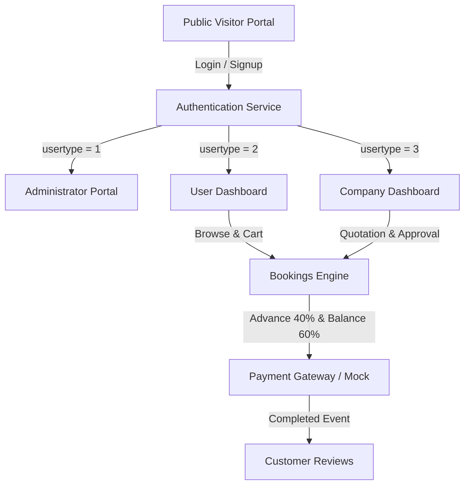

# Crystal Events - Event Management Platform

Crystal Events is a comprehensive web-based event planning and management platform built with PHP and MySQL. It connects clients planning events (weddings, corporate conferences, birthdays, stage shows, catering, etc.) with verified event management companies and service providers.

This version has been modernized and hardened for **PHP 8.5+** on local XAMPP environments with complete database schemas, seeded test data, robust security remediations, and mock payment workflows.

---

## Table of Contents
1. [Key Features](#key-features)
2. [Tech Stack & System Requirements](#tech-stack--system-requirements)
3. [Local Setup & Running (XAMPP)](#local-setup--running-xampp)
4. [Central Configuration (`config.php`)](#central-configuration-configphp)
5. [Payment Integration & Mock Mode](#payment-integration--mock-mode)
6. [Test Accounts & Credentials](#test-accounts--credentials)
7. [System Architecture & Roles](#system-architecture--roles)
8. [Database Schema](#database-schema)
9. [Security Remediations](#security-remediations)

---

## Key Features
- **Visitor Portal**: Interactive landing page, responsive company showcase, verified badges, rating summaries, customer reviews, category filtering, and direct contact inquiry form.
- **Client (User) Dashboard**:
  - Event catalog browsing with dynamic keyword and category filters.
  - Multi-item booking cart with event date/time, venue details, district selector, and special requirements.
  - Lifecycle booking tracking (Pending &rarr; Approved &rarr; Advance Paid (40%) &rarr; Balance Paid (60%) &rarr; Completed).
  - Built-in Mock Payment Gateway and live Razorpay gateway support.
  - Review & 5-star rating submission upon event conclusion.
  - Direct inquiry and complaint ticket filing with status tracking.
- **Company (Organizer) Dashboard**:
  - Real-time business metrics: Total Events, Pending Enquiries, Approved Bookings, Completed Events, Booked Revenue, Average Rating.
  - Complete Event Catalog management (Add, Edit, Delete events).
  - Booking quotation & management: Approve with custom price quote or reject with a reason.
  - Mark fully paid bookings as completed.
  - Photo gallery showcase management with secure image uploads.
  - Organizer profile management and avatar upload.
- **Administrator Dashboard**:
  - Global platform analytics (Registered Users, Verified Companies, Total Events, Total Bookings, Platform Payments, and Messages).
  - Account verification portal: Review pending users and companies, approve or reject them.
  - Category management: Add new event categories.
  - Client complaint review and response portal.
  - Contact inquiry messages viewer.

---

## Tech Stack & System Requirements
- **Server Environment**: Apache 2.4+ (Configured on Port 8080)
- **Runtime**: PHP 8.1 - PHP 8.5+ (64-bit)
- **Database**: MySQL 5.7+ / MariaDB 10.4+ (`utf8mb4` charset)
- **Frontend**: HTML5, CSS3, JavaScript, jQuery 3.6+, Bootstrap 4 / Bootstrap 5, SweetAlert2, DataTables

---

## Local Setup & Running (XAMPP)

### 1. Project Location
Ensure the project is located at:
```
C:\xampp\htdocs\Crystal-Events\
```

### 2. Apache Port 8080 Configuration
To prevent conflicts with existing local services (e.g., Windows IIS / `w3svc`), configure Apache to listen on port 8080:
1. Open `C:\xampp\apache\conf\httpd.conf`.
2. Update:
   ```apache
   Listen 8080
   ServerName localhost:8080
   ```
3. Start or restart the Apache and MySQL services from the XAMPP Control Panel.
4. Access the platform at:
   ```
   http://localhost:8080/Crystal-Events/
   ```

### 3. Database Import
1. Ensure MySQL is running on port 3306.
2. The complete schema and seed dataset are located in `database/crystal_events.sql`.
3. Import the database using PowerShell or MySQL CLI:
   ```powershell
   Get-Content database\crystal_events.sql | & "C:\xampp\mysql\bin\mysql.exe" -u root
   ```
4. This creates the database `crystal-events` with all tables, primary keys, foreign keys (`ON DELETE CASCADE`), indexes, and realistic seed data.

---

## Central Configuration (`config.php`)

All database settings, base URLs, and payment gateway keys are centralized in `config.php`:

```php
// Database Configuration
define('DB_HOST', 'localhost');
define('DB_USER', 'root');
define('DB_PASS', '');
define('DB_NAME', 'crystal-events');
define('DB_PORT', 3306);

// Application Configuration
define('BASE_URL', 'http://localhost:8080/Crystal-Events/');
define('TIMEZONE', 'Asia/Kolkata');

// Payment Gateway Configuration
define('MOCK_PAYMENTS', true); // Set to true for local testing without real Razorpay transactions
define('RAZORPAY_KEY_ID', 'rzp_test_rWSgaJR2BxzRC3');
define('RAZORPAY_KEY_SECRET', 'YOUR_KEY_SECRET_HERE');
```

---

## Payment Integration & Mock Mode

The platform supports a 2-stage milestone payment model:
1. **Advance Payment (40%)**: When a company approves a booking and provides a price quote, the user pays a 40% deposit.
2. **Balance Payment (60%)**: Once the event date approaches, the user pays the remaining 60% balance.

### Mock Payments Mode (`MOCK_PAYMENTS = true`)
- Enabled by default in `config.php`.
- In the User Approved Bookings view (`users/user/book_approved.php`), clicking **Pay Advance Now** or **Pay Balance Now** triggers a SweetAlert modal simulating the payment.
- The server validates ownership, calculates the exact milestone amount server-side (`round($price * 0.40)` and `$price - round($price * 0.40)`), records the transaction in `payment`, updates `bookings.pay_id1` or `bookings.pay_id2`, and prevents duplicate payments.

### Live Razorpay Mode (`MOCK_PAYMENTS = false`)
- Set `define('MOCK_PAYMENTS', false);` and supply your `RAZORPAY_KEY_ID` and `RAZORPAY_KEY_SECRET` in `config.php`.
- Opens the official Razorpay Checkout popup and verifies the HMAC-SHA256 signature server-side before recording payments.

---

## Test Accounts & Credentials

All seeded accounts use secure bcrypt password hashes.

| Role | Email | Password | Access Level |
| :--- | :--- | :--- | :--- |
| **Administrator** | `admin@crystalevents.com` | `admin123` | Full Admin Panel (`/users/admin/`) |
| **Client / User** | `autodoc@gmail.com` | `Test@123` | Client Dashboard (`/users/user/`) |
| **Client / User** | `user1@gmail.com` | `Test@123` | Client Dashboard (`/users/user/`) |
| **Client / User** | `user2@gmail.com` | `Test@123` | Client Dashboard (`/users/user/`) |
| **Company Organizer** | `cevexcorporate@gmail.com` | `Test@123` | Company Dashboard (`/users/company/`) |
| **Company Organizer** | `dolphinevents@gmail.com` | `Test@123` | Company Dashboard (`/users/company/`) |
| **Company Organizer** | `eventiquehouse@gmail.com` | `Test@123` | Company Dashboard (`/users/company/`) |
| **Company Organizer** | `executiveevents@gmail.com` | `Test@123` | Company Dashboard (`/users/company/`) |
| **Company Organizer** | `fonixevents@gmail.com` | `Test@123` | Company Dashboard (`/users/company/`) |

*Note: Newly registered accounts start with `status = 0` (Pending Verification) and are restricted to their Profile page until approved by the Administrator in the Admin Panel.*

---

## System Architecture & Roles



- **Visitor**: View landing page, verified companies, ratings, and submit contact messages.
- **User (`usertype = 2`)**: Browse events, add to cart, submit booking requests, pay 40% advance and 60% balance, rate & review events, submit complaints.
- **Company (`usertype = 3`)**: Manage event catalogue, approve booking requests with price quotations or reject with reasons, upload gallery photos, update company profile, track revenues.
- **Admin (`usertype = 1`)**: Approve/reject user and company registrations, manage event categories, reply to complaints, view inquiries, view aggregate platform metrics.

---

## Database Schema
The database `crystal-events` consists of 12 relational tables:
1. `login`: User credentials, bcrypt hashed passwords, role (`usertype`), and verification `status`.
2. `users`: Client personal details, address, contact, and profile avatar.
3. `company`: Organizer business profile, owner name, address, IFSC/bank details, about text, avatar.
4. `category`: Event category definitions (Wedding, Birthday, Corporate, Stage Decoration, Catering, etc.).
5. `events`: Events listed by companies, linked to category and company email.
6. `gallery`: Photos and captions uploaded by organizers.
7. `cart`: Temporary shopping cart items per user.
8. `bookings`: Event bookings with location, requirements, quotation `price`, `book_status`, and payment links.
9. `payment`: Recorded milestone payments with timestamps, amounts, and gateway reference IDs.
10. `review`: Client reviews with star ratings (1 to 5) linked to completed bookings.
11. `complaint`: User grievances with submission timestamps, replies, and status.
12. `contact`: Public contact inquiries submitted from the website.

---

## Security Remediations

1. **SQL Injection Defense**: Replaced all dynamic SQL string concatenations with parameterized queries (`mysqli_stmt_bind_param`) using custom query helpers (`sel`, `insert`, `update`, `delete`, `num`).
2. **Access Control (RBAC)**: All user, company, and admin pages and endpoints enforce role validation (`usertype`) in PHP sessions. Unauthorized or missing sessions trigger HTTP 302 redirects to `login.html` followed by immediate script execution termination (`exit;`). API endpoints return HTTP 401/403 JSON responses.
3. **Password Security**: Replaced plaintext password storage with `password_hash()` (bcrypt) and `password_verify()`. Integrated a one-time migration on login that automatically re-hashes legacy plaintext passwords upon successful authentication.
4. **File Upload Security**:
   - File uploads (`profile_pic.php`, `gallery.php`) validate MIME types using PHP `finfo` (`FILEINFO_MIME_TYPE`), check image integrity via `getimagesize()`, enforce a 5 MB maximum size limit, and reject any non-whitelisted extensions (only `.jpg`, `.jpeg`, `.png`, `.webp` allowed).
   - Filenames are randomized on the server using cryptographically secure random bytes (`bin2hex(random_bytes(16))`). Original client filenames are never preserved.
   - Dedicated `.htaccess` files inside each upload directory explicitly disable PHP script execution (`Require all denied` for `.php`, `php_flag engine off`, `Options -ExecCGI`).
5. **Cross-Site Scripting (XSS)**: All user-supplied and database-retrieved strings are escaped using `safe_html()` (`htmlspecialchars($val, ENT_QUOTES, 'UTF-8')`).
6. **Payment Tampering Protection**:
   - Payment amounts are calculated strictly server-side (40% advance, 60% balance) based on the database price quote, never trusting the client-submitted amount.
   - Ownership verification guarantees users can only pay for their own bookings.
   - Idempotency checks prevent duplicate payments for the same milestone.
   - Live Razorpay mode verifies server-side HMAC-SHA256 signatures before recording payments.
